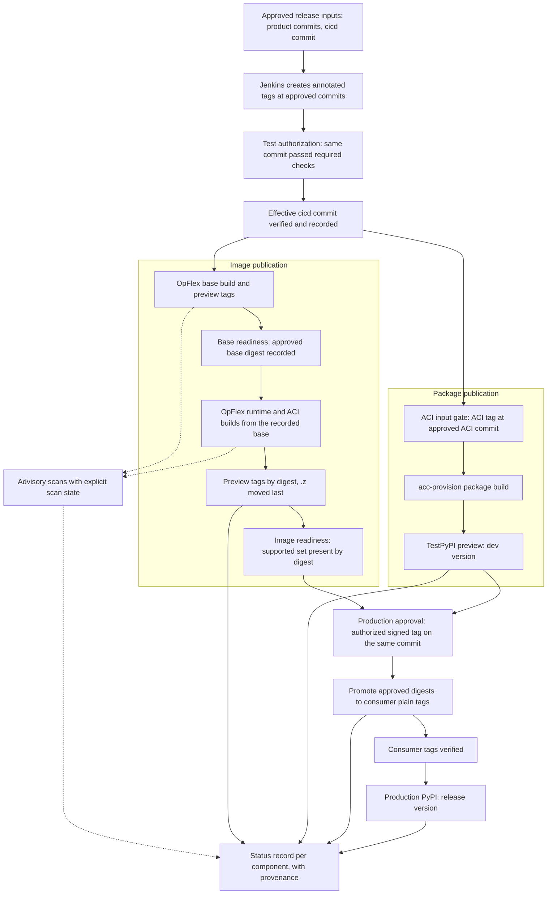

# ACI Containers Build and Release Process

> **Target process. Implementation is pending.** This guide describes how the GitHub Actions build and release process operates once the agreed changes land. [Section 1](#1-status) shows which controls are deployed today and which pull request or follow-up batch delivers the rest. Treat a control as active only when its status row says it's deployed.

**Source baseline checked:** 2026-10-27. Statements about deployed behavior were checked against these public revisions. The target pipeline hasn't been run end to end.

| Repository | Revision |
|---|---|
| cicd `mmr-6.1.1` | [`f2a51cf5`](https://github.com/noironetworks/cicd/tree/f2a51cf597eb5b37faf7df720793b310bd2b7657) |
| aci-containers `mmr-6.1.1` | [`7a10b170`](https://github.com/noironetworks/aci-containers/tree/7a10b17098fbbae72b91674e03215b2a646a01dd) |
| opflex `mmr-6.1.1` | [`ba1fd7da`](https://github.com/noironetworks/opflex/tree/ba1fd7da1009827aa4fae4ec3888b87719fa204a) |
| acc-provision `mmr-6.1.1` | [`b3183b58`](https://github.com/noironetworks/acc-provision/tree/b3183b58a8e550274a07618f97561946d59770bb) |
| Open PR set | [cicd #88](https://github.com/noironetworks/cicd/pull/88) at `eabfe142`, [aci-containers #1797](https://github.com/noironetworks/aci-containers/pull/1797) at `66b550cc`, [opflex #697](https://github.com/noironetworks/opflex/pull/697) at `ccd2f61d`, [acc-provision #1469](https://github.com/noironetworks/acc-provision/pull/1469) at `77424752` |

**Scope:** the MMR 6.1.1 release line. Default branches move to the same process later, one repository at a time.

Detailed findings, acceptance scenarios and remediation batches B0 to B6 are in the [GitHub Actions resilience audit](https://github.com/noironetworks/cicd/blob/9b87ae99af0bb8ce59b42e76b052ce42a3f2e1b9/docs/audits/2026-10-26-github-actions-resilience-audit.md). This guide uses the audit's batch names.

## Contents

1. [Status](#1-status)
2. [Architecture and ownership](#2-architecture-and-ownership)
3. [Release preparation](#3-release-preparation)
4. [Validation and authorization](#4-validation-and-authorization)
5. [Image publication](#5-image-publication)
6. [Package publication](#6-package-publication)
7. [Status, scans and provenance](#7-status-scans-and-provenance)
8. [Recovery and rehearsal](#8-recovery-and-rehearsal)
9. [Reference](#9-reference)

## 1. Status

"Open PR set" means the four PRs listed above, together with the review fixes agreed for them. The open PR set must land together through a pinned-revision cutover (see [current limitations](#12-current-limitations)).

### 1.1 Capability status

| Capability | Deployed today | Delivered by |
|---|---|---|
| Jenkins creates annotated numeric release tags | Yes | Unchanged |
| Tag-triggered release workflows for acc-provision, aci-containers and OpFlex on `mmr-6.1.1` | Yes | Unchanged |
| Tag is annotated and points at the approved commit | Partly: compared with the live branch head | B3, B4 |
| Same-commit test authorization before publication | No | B0 (required checks), B3 (release gate) |
| Approved cross-repository inputs | No | B1, B3 |
| Effective cicd commit verified and recorded | Partly: ACI and OpFlex | Open PR set fix, then B3 |
| OpFlex base ready before its consumers | Partly: OpFlex runtime only | B3 |
| ACC's ACI input gated on the approved ACI commit | No | B1 |
| Digest-verified preview tags, `.z` moved last | Yes | Open PR set fix keeps it |
| Scans advisory and never blocking publication | No | Open PR set fix, B2 |
| Explicit scan state from publisher to portal | No | B2 |
| One status write per component from retained per-image evidence | Yes: ACI and OpFlex | Open PR set fix keeps it |
| Bounded normal pushes to the status repository | Partly: ACI and OpFlex; ACC retries without limit | cicd #88 (ACC), B2, B4 |
| Status token present only in the status step | Partly: ACI | Open PR set fix, B5 |
| Selectable status branch (`CICD_STATUS_BRANCH`) | In the ACI and OpFlex publishers; workflows don't set it | Open PR set fix keeps it, B4 |
| Actual build-time base recorded per image | No: host images | Open PR set fix, B2 |
| Obsolete Travis publication hard-disabled | Partly | Open PR set fix, B6 |
| Authorized signature verification for production | No | B0 |
| Consumer plain tags promoted from approved digests | No | B1 |
| Production PyPI only after consumer tags are verified | No | B1 |
| Checksum-aware TestPyPI and PyPI recovery | No | B4 |
| Status-only repair | No | B4 |
| Durable provenance beyond workflow artifacts | Partly: ACI and OpFlex status records | B4 |
| No force-push of release tags or status history | No | B2 (status), B4 (tags) |
| Failure notification and missed-run detection | No | B2 |
| Pinned scanners and executable inputs; base-image mirror | No | B5, [cicd #83](https://github.com/noironetworks/cicd/pull/83) |
| cicd PR checks for shared scripts | No | B3 |
| Default branches migrated | No | B6 |

### 1.2 Current limitations

Each row is labeled **Deployed** (live `mmr-6.1.1` behavior) or **Proposed** (behavior the open PR set would introduce as currently written). The target chapters that follow don't repeat these limitations.

| Label | Limitation | Resolved by |
|---|---|---|
| Deployed | A workflow rerun rebuilds and re-pushes every image or package; there's no status-only repair. A same-day rerun attempt rewrites the dated tag. | B4 |
| Deployed | The tag check compares the tagged commit with the *current* source-branch head, so a rerun fails after any later merge. | B3, B4 |
| Deployed | cicd is cloned by branch name. The `CICD_BRANCH` repository variable can redirect it; none was set at the baseline. ACC doesn't record the cicd commit it used. | Open PR set fix, B3 |
| Deployed | Unit tests skip tag events, and publication doesn't wait for or verify the tagged commit's branch tests. | B0, B3 |
| Deployed | Scans run after each image's push. A scanner failure stops later images and the status write. | B2 |
| Deployed | A missing scan report fails the ACI or OpFlex status write; an empty or unparseable report counts as zero vulnerabilities ([parser](https://github.com/noironetworks/cicd/blob/f2a51cf597eb5b37faf7df720793b310bd2b7657/travis/update-github-actions-release.py#L128-L157)). | B2 |
| Deployed | Every ACI image except openvswitch records the controller's base (`ubi9/ubi`), but the host images build on `ubi9/ubi-minimal` ([source](https://github.com/noironetworks/cicd/blob/f2a51cf597eb5b37faf7df720793b310bd2b7657/travis/build-push-aci-containers-images.sh#L96-L98)). | B2; prototype in cicd [`3cc1cfd`](https://github.com/noironetworks/cicd/commit/3cc1cfdeb42a0ba3c282ef5aa2c8e10e385809f8) |
| Deployed | ACI copies its iptables bundle from `opflex-build-base:<release>.<upstream>.z` with no readiness or digest check. | B3 |
| Deployed | ACC builds `acikubectl` from whatever aci-containers tag has the same name, without checking it against an approved commit ([source](https://github.com/noironetworks/acc-provision/blob/b3183b58a8e550274a07618f97561946d59770bb/.github/workflows/acc-provision-tag-publish.yml#L229-L247)). | B1 |
| Deployed | Consumer plain tags aren't pushed, but the production package references them. | B1 |
| Deployed | The production PyPI signature check searches the verification output for a key fingerprint instead of requiring a valid signature from an authorized key. | B0 |
| Deployed | Re-uploading an existing TestPyPI or PyPI version fails, with no checksum comparison. | B4 |
| Deployed | ACC status uses the legacy writer, which retries without limit ([source](https://github.com/noironetworks/cicd/blob/f2a51cf597eb5b37faf7df720793b310bd2b7657/travis/push-to-cicd-status.sh#L122)). | cicd #88, B4 |
| Deployed | The OpFlex runtime build step, not only its status step, receives the status token. | B5 |
| Deployed | ACC's Travis `push-package` stage remains eligible for non-numeric tags such as release candidates. Whether it runs depends on Travis service settings, which weren't inspected. | Open PR set fix, B6 |
| Deployed | OpFlex's `*-opflex-build-base` tag workflow polls the Travis API in a loop with no timeout of its own. | B6 |
| Deployed | Workflow artifacts expire after 14 days, and no failure notification or missed-run detection exists. An external scheduled writer has force-pushed status history (audit OP-1). | B2, B4 |
| Proposed | cicd #88 replaces the batched ACI and OpFlex status publisher with a [helper that takes one image](https://github.com/noironetworks/cicd/blob/eabfe142a84564e6b3dd9c2c3cdf8cd835521895/travis/push-to-cicd-status.sh#L9-L15) and copies [shared `/tmp` reports](https://github.com/noironetworks/cicd/blob/eabfe142a84564e6b3dd9c2c3cdf8cd835521895/travis/push-to-cicd-status.sh#L84-L96) that the next image overwrites. Status runs inside the image loop. | Open PR set fix |
| Proposed | Scans run before each push, so a scanner failure withholds that image and every later one. A status failure after image N is pushed withholds images after N. | Open PR set fix |
| Proposed | noirolabs `.z` moves before the consumer copies, and per-registry digest manifests are dropped. | Open PR set fix |
| Proposed | The legacy updater counts a missing or table-less report as zero, and records digests by pulling mutable tags at record time. | Open PR set fix, B2 |
| Proposed | The cicd branch-head check and `CICD_STATUS_BRANCH` support are removed. | Open PR set fix |
| Proposed | `CI_PROVIDER: travis` re-enables Travis publish jobs, and the provider selector parses `.travis.yml` with `awk` instead of a YAML parser. | Open PR set fix |
| Proposed | The ACI build step, not only the status step, receives the status token. | Open PR set fix |
| Proposed | No staggered merge order is safe: cicd first breaks product runs partway through publication, and products first produce green runs without status. | Pinned-revision cutover with commit verification |

## 2. Architecture and ownership

| Role | Owner | Responsibility |
|---|---|---|
| Release owners | Release maintainers | Approve release inputs, request tags, approve production |
| Tag producer | Jenkins (configuration outside this repository) | Creates annotated numeric release tags at approved commits |
| Release workflows | GitHub Actions in acc-provision, aci-containers and opflex | Validate, build, publish and record results |
| Shared implementation | cicd [`travis/`](https://github.com/noironetworks/cicd/tree/f2a51cf597eb5b37faf7df720793b310bd2b7657/travis) scripts | Build, push, scan and status logic. The directory name is historical; GitHub Actions calls these scripts directly. |
| Release records | [cicd-status](https://github.com/noironetworks/cicd-status) `main` | Release records, scan reports and the status portal |

Jenkins remains the tag producer; GitHub Actions doesn't create release tags.

Travis isn't part of the release path. Obsolete Travis publication stays hard-disabled: no repository setting or variable re-enables Travis publish jobs. A supported Travis fallback would need a separately reviewed design and isn't described here.

### Target flow

Solid edges are gates: a step starts only after the step before it succeeds. Dashed edges are advisory: a scan failure never blocks publication or the status record.

### Repository map

| Repository | Release workflow on `mmr-6.1.1` | Role |
|---|---|---|
| opflex | [`opflex-images.yml`](https://github.com/noironetworks/opflex/blob/ba1fd7da1009827aa4fae4ec3888b87719fa204a/.github/workflows/opflex-images.yml) | Publishes `opflex-build-base`, then the `opflex` runtime image |
| aci-containers | [`aci-containers-images.yml`](https://github.com/noironetworks/aci-containers/blob/7a10b17098fbbae72b91674e03215b2a646a01dd/.github/workflows/aci-containers-images.yml) | Publishes eight ACI images |
| acc-provision | [`acc-provision-tag-publish.yml`](https://github.com/noironetworks/acc-provision/blob/b3183b58a8e550274a07618f97561946d59770bb/.github/workflows/acc-provision-tag-publish.yml) | Publishes the `acc-provision` package to TestPyPI or PyPI |
| cicd | No release workflow | Shared scripts and the release version (`travis/globals.sh`) |
| cicd-status | Not applicable | Release records and portal |

## 3. Release preparation

### 3.1 Version update points

A release bump touches these values, which must agree:

- cicd [`travis/globals.sh`](https://github.com/noironetworks/cicd/blob/f2a51cf597eb5b37faf7df720793b310bd2b7657/travis/globals.sh): `RELEASE_TAG` (for example `6.1.1.8`).
- The `UPSTREAM_ID` Actions variable in each of acc-provision, aci-containers and opflex (for example `81c2369`).
- acc-provision `provision/setup.py`: the package version.
- acc-provision `provision/acc_provision/versions.yaml`: image pins in the form `<release>.<upstream>`.
- The matching Jenkins release configuration, which is maintained outside this repository.

The release workflows reject a tag that doesn't equal the cicd `RELEASE_TAG`.

### 3.2 Approved release inputs

Before tagging, the release owners review and record one set of release inputs:

- the commit to release in each product repository;
- the cicd commit every release job will use;
- the supported image set ([section 3.3](#33-supported-image-set));
- after the OpFlex base job, the approved `opflex-build-base` digest;
- the aci-containers commit that acc-provision embeds.

Every gate in this guide compares against this record, not against current branch heads or moving aliases. B1 defines the record's format and location.

### 3.3 Supported image set

The supported set is nine runtime images plus the `opflex-build-base` build dependency. [Section 9.1](#91-image-inventory) lists them.

- The retired `acc-provision-operator` image isn't part of the set. Don't confuse it with `aci-containers-operator`, which is.
- `versions.yaml` pins `gbp_version` and `opflex_server_version`, but no release workflow produces those images. `opflex_server_version` is treated as a historical pin. Each key must be classified as required, optional or unused before production readiness checks rely on it (B1). Neither is a supported deliverable until it's classified.

## 4. Validation and authorization

### 4.1 Pull request validation

Unprivileged tests run on pull requests and branch pushes, without publication credentials. On `mmr-6.1.1`, these checks are required before merging (B0):

- acc-provision: `Lint and unit tests`
- aci-containers: `ACI unit tests`
- opflex: `OpFlex unit tests`

cicd gains PR checks for its shared scripts and updaters (B3).

### 4.2 Tag-time checks

Each release workflow verifies, before any registry or package authentication:

- the tag has the form `N.N.N.N` and equals the cicd `RELEASE_TAG`;
- the tag is annotated;
- the tagged commit is the approved commit for that repository;
- `UPSTREAM_ID` is set and well formed.

Jenkins creates the tag at the approved commit, which is the source-branch head at tagging time. That check belongs to tag creation. Later recovery uses the recorded commit and doesn't require the branch head to be unchanged.

Push only the intended tag refs. GitHub creates no push events for tags when more than three tags are pushed at once, so bulk tag pushes can silently skip release workflows.

### 4.3 Test authorization

Before registry authentication, the release job confirms that the tagged commit passed its required tests:

- the run is a branch-push run of the expected workflow and job;
- it's the latest attempt for that commit;
- it completed successfully, because skipped or neutral results don't count.

A failed or missing test result stops publication before any credential is used (B3).

### 4.4 Effective cicd commit

The job resolves the cicd commit it actually checked out, including when the `CICD_BRANCH` repository variable overrides the default branch name. It compares that commit with the approved cicd commit and fails on a mismatch.

The verified commit is recorded in the run's artifacts and the status record. Every later job and every retry fetches that exact commit and checks `HEAD`. `git clone --branch` accepts branch and tag names but not commit SHAs, so pinning means fetching by commit and verifying it.

### 4.5 Dependency readiness

- **OpFlex base first.** The OpFlex base job publishes `opflex-build-base` and records its digest. The OpFlex runtime build and the ACI build start only after that readiness record exists, and they use the recorded digest rather than whatever `.z` currently points to.
- **ACC's ACI input.** On the package path, before building, the acc-provision workflow verifies that the aci-containers `<release>` tag resolves to the approved ACI commit, and builds `acikubectl` from that commit only. The production package also waits for image readiness and consumer promotion ([section 6.3](#63-production-pypi)).
- **Release records.** The release and stream entries exist in cicd-status before any component writes status. They're seeded idempotently (B3).

## 5. Image publication

### 5.1 Order

1. OpFlex publishes `opflex-build-base` and records its digest.
2. OpFlex runtime and ACI images build from the recorded base and publish preview tags.
3. Image readiness confirms the supported set.
4. After production approval, consumer plain tags are promoted from the approved digests.

### 5.2 Registry and tag contract

Examples use release `6.1.1.8` and upstream `81c2369`.

| Tag | Example | Registries | Kind | Behavior |
|---|---|---|---|---|
| Plain (preview) | `6.1.1.8.81c2369` | `quay.io/noirolabs` | Preview | Written by each run |
| Dated | `6.1.1.8.81c2369.MMDDYY.<run_number>` | `quay.io/noirolabs`, `quay.io/noiro`, `docker.io/noiro` | Preview | One per run; identifies the build |
| `.z` | `6.1.1.8.81c2369.z` | `quay.io/noirolabs`, `quay.io/noiro`, `docker.io/noiro` | Preview | Moving alias for downstream builds and TestPyPI packages |
| Plain (consumer) | `6.1.1.8.81c2369` | `quay.io/noiro`, `docker.io/noiro` | Production | Set once by promotion from an approved digest; referenced by the production package |

The external tag formats don't change.

### 5.3 Preview publication

For each image, the job pushes tags in this order and records every pushed digest in a manifest for that registry:

1. noirolabs plain;
2. noirolabs dated;
3. `quay.io/noiro` dated;
4. Docker Hub dated;
5. `.z` on `quay.io/noiro`;
6. `.z` on Docker Hub;
7. `.z` on noirolabs, last, because downstream builds read noirolabs `.z`.

Each alias must match the digest already recorded for that registry; a mismatch stops the job. This is the deployed order in [`push-images.sh`](https://github.com/noironetworks/cicd/blob/f2a51cf597eb5b37faf7df720793b310bd2b7657/travis/push-images.sh#L156-L187).

Moving `.z` last orders dependencies only. It doesn't establish production readiness.

### 5.4 Readiness and consumer promotion

**Image readiness** passes when every image in the supported set exists in each registry at its recorded digest, and was built from the approved inputs.

After production approval, consumer plain tags on `quay.io/noiro` and `docker.io/noiro` are created from the approved digests, by copying rather than rebuilding, and then verified (B1). The promotion tool is defined in B1.

Promotion is resumable for each registry, not atomic. If it stops partway, it resumes from the recorded digests; published tags are never rolled back.

## 6. Package publication

TestPyPI and production PyPI are separate publications with different triggers, versions and gates.

### 6.1 Selecting the publication

The acc-provision tag message selects exactly one registry: `release to test.pypi.org` or `release to pypi.org`. A message with both phrases or neither fails.

### 6.2 TestPyPI preview

| Rule | Value |
|---|---|
| Trigger | Annotated tag at the approved commit, with the TestPyPI message |
| Version | `<release>.dev<run_number>`, for example `6.1.1.8.dev123` |
| Image references | `versions.yaml` is rewritten to the preview `.z` tags |
| Gates | Tag-time checks, test authorization, effective cicd commit, ACI input gate |
| Status | `z` stream record |
| Existing version | A rerun attempt reuses the run number, and so the version. Compare the SHA-256 of the recorded artifact with the file already on TestPyPI. If they match, the upload is complete; continue to the status write. If they differ, stop. A new workflow run gets a new version. |

### 6.3 Production PyPI

| Rule | Value |
|---|---|
| Trigger | An authorized signed tag on the same commit, with the production message. This same-commit signing conversion is the only permitted tag change. |
| Version | `<release>`, for example `6.1.1.8` |
| Image references | `versions.yaml` keeps the consumer plain tags |
| Gates | Valid signature from an authorized key (B0), image readiness, consumer tags verified (B1), plus the TestPyPI gates |
| Status | `r` stream record |
| Existing version | Compare the SHA-256 of the recorded artifact with the published file. If they match, the upload is complete; repair status only. If they differ, stop. PyPI never accepts a different file under an existing file name, so a corrected package needs a new version chosen by the release owners. |

After production completes, the tag object and its commit are frozen.

## 7. Status, scans and provenance

### 7.1 Status record

Each component writes one status commit per publication, after all of its artifacts are published:

- aci-containers writes one commit for its eight images.
- OpFlex writes one commit for the runtime image, with the base recorded as an input.
- acc-provision writes one commit for the package.

The writer reads retained evidence from the run's artifact directory: each image's own scan reports, base identity and per-registry digests. It never reads shared temporary files that a later image could overwrite. ACI and OpFlex already work this way through [`publish-github-actions-test-status.sh`](https://github.com/noironetworks/cicd/blob/f2a51cf597eb5b37faf7df720793b310bd2b7657/travis/publish-github-actions-test-status.sh#L123-L160).

Writes use normal pushes with up to three fresh-clone attempts when another writer moves the branch. These attempts bound conflict retries only. They don't set operation timeouts or make recovery idempotent; step timeouts and status-only repair cover those. If the record is already current, the writer exits without a commit. No writer force-pushes status history.

Before the first write, the writer prints and verifies its destination repository and branch.

### 7.2 Scans

Scans are advisory. A scanner outage or error never blocks image publication, package publication or the status write.

Each scan result carries an explicit state (ok, unavailable, error or stale), the scanner and version, and the time. That state must survive all three stages that handle it:

- the publisher that writes the release record;
- the scheduled CVE refresher that updates reports later;
- the portal renderer that displays them.

A missing, empty or unparseable report is shown as its state, never as zero vulnerabilities. Placeholder report text alone isn't enough, because a count-only parser reads it as zero. Report writers are closed before parsing.

Each image records its actual build-time base. The aci-containers host images use `ubi9/ubi-minimal`.

### 7.3 Provenance

The status record keeps, beyond the 14-day artifact retention:

- source commit and tag;
- cicd commit;
- approved inputs;
- digests for each registry;
- package file SHA-256;
- run URL and attempt.

### 7.4 Failure notification and missed runs

A release job that fails, is cancelled or times out produces one deduplicated notification with the tag, run link and failed job.

An independently owned monitor detects:

- pushed release tags with no run;
- disabled workflows;
- stale status;
- disagreement between registries and status.

Owners configure the destination and thresholds; this guide doesn't define them (B2).

## 8. Recovery and rehearsal

### 8.1 Principles

- Move forward; never roll back published tags or packages.
- Recover from the recorded approved inputs (source commit, cicd commit, digests and package artifact), not from current branch heads or moving aliases.
- Never create a second release tag. The only permitted tag change is the same-commit signing conversion before production.

### 8.2 Failure outcomes

| Failure | Target outcome | Recovery |
|---|---|---|
| Required test failed or missing | Stops before registry authentication; nothing is published | Release owners decide how to proceed; this guide doesn't define tag replacement |
| Scanner outage | Artifacts and status are published; scan state is unavailable or error | A later scan or refresh updates the state |
| Registry push fails partway | Earlier tags stay; the manifests record what was published; status records a partial result | Resume publication from the recorded inputs, registry by registry |
| Status write fails after publication | Artifacts stay published; the run fails visibly | Status-only repair from recorded evidence, without rebuilding |
| Package version already exists | Checksum comparison ([section 6](#6-package-publication)) | If they match, repair status only; if they differ, stop |
| Source branch moved after tagging | No effect on recovery | Recovery uses the recorded commit |
| cicd branch overridden or moved | Mismatch with the approved cicd commit fails before the build | Correct the variable, or approve a new cicd commit |
| Consumer promotion partial | Promotion resumes for each registry | Resume from the approved digests |
| Rehearsal destination misconfigured | Refused before the first write | Correct the destination |

### 8.3 Rehearsal

A rehearsal writes only to an isolated destination. Before its first write, the job prints and verifies the selected status repository and branch, and refuses production `cicd-status` `main`.

Setting a branch variable alone isn't enough. The deployed publishers fix the repository and default the branch to `main`, and the workflows don't pass a branch override. Rehearsal image and package destinations need the same verification, and their design is part of B4.

## 9. Reference

### 9.1 Image inventory

| Image | Producer | `versions.yaml` key |
|---|---|---|
| `opflex-build-base` | opflex, base job | none (build dependency) |
| `opflex` | opflex, runtime job | `opflex_agent_version` |
| `aci-containers-host` | aci-containers | `aci_containers_host_version` |
| `aci-containers-host-ovscni` | aci-containers | `aci_containers_host_ovscni_version` |
| `aci-containers-controller` | aci-containers | `aci_containers_controller_version` |
| `aci-containers-operator` | aci-containers | `aci_containers_operator_version` |
| `aci-containers-webhook` | aci-containers | `aci_containers_webhook_version` |
| `aci-containers-certmanager` | aci-containers | `aci_containers_certmanager_version` |
| `cnideploy` | aci-containers | `cnideploy_version` |
| `openvswitch` | aci-containers | `openvswitch_version` |

Pinned without a producer, pending classification: `gbp_version` and `opflex_server_version`. Retired: `acc-provision-operator`.

### 9.2 Release checklist

1. Merge the version bumps ([section 3.1](#31-version-update-points)) and confirm the required checks passed.
2. Record the approved release inputs ([section 3.2](#32-approved-release-inputs)).
3. Tag opflex. Confirm the base readiness record and the runtime publication.
4. Tag aci-containers. Confirm all eight images are published by digest and status is recorded.
5. Tag acc-provision with the TestPyPI message. Confirm the preview package and its status.
6. Confirm image readiness, and review scan states (advisory).
7. Production approval: an authorized maintainer performs the same-commit signing conversion on the acc-provision tag.
8. Confirm consumer promotion, the production PyPI upload and the `r` stream status.
9. Confirm the tags are frozen and the provenance is recorded.

### 9.3 Troubleshooting

These symptoms come from deployed workflow and script messages.

| Symptom | Check |
|---|---|
| No workflow run for a tag | Tag form is `N.N.N.N`; the tag was pushed on its own, not with more than three tags at once |
| Tag must be annotated | Jenkins must create an annotated tag |
| Tag resolves to a commit that isn't the current branch head | The branch moved after tagging; see [current limitations](#12-current-limitations) |
| CICD release doesn't match the tag | cicd `RELEASE_TAG`, or the effective cicd branch |
| CICD checkout doesn't match the branch head | The cicd branch moved during the run, or a branch variable is set |
| `UPSTREAM_ID` is empty | The repository's `UPSTREAM_ID` variable |
| Tag must select exactly one PyPI registry | The acc-provision tag message ([section 6.1](#61-selecting-the-publication)) |
| A `.z` or dated digest doesn't match the plain tag | Registry inconsistency; stop and investigate. Don't move tags by hand. |
| Missing scan artifact in the status step | See [current limitations](#12-current-limitations); the images are already published |
| Status push failed after three fresh-clone attempts | Status contention; the artifacts are already published |
| Upload rejected because the file already exists | Compare checksums ([section 6](#6-package-publication)) |

### 9.4 Travis-compatible variables

The workflows export Travis-era names so the shared scripts run unchanged.

| Variable | GitHub Actions source |
|---|---|
| `TRAVIS_TAG` | The release tag (equal to the trigger tag) |
| `TRAVIS_COMMIT` | The tagged source commit |
| `TRAVIS_BUILD_NUMBER` | `github.run_number` (rerun attempts reuse it) |
| `TRAVIS_REPO_SLUG` | `github.repository` |
| `TRAVIS_JOB_WEB_URL` | The workflow run URL (acc-provision) |
| `TRAVIS_BUILD_USER` | Fixed value in acc-provision; selects TestPyPI dev versioning |
| `TRAVIS_TAGGER` | Status repository token, where the legacy writer is used |

GitHub Actions only:
- `GHA_TRIGGER_TAG`;
- `GHA_DATE_TAG` (`MMDDYY`);
- `GHA_OPFLEX_BUILD_PHASE` (base or runtime);
- `CI_ARTIFACT_DIR`;
- `SKIP_CICD_STATUS`, a repository variable that defaults to `true` in the ACI and OpFlex workflows.

### 9.5 Local builds

This guide covers release automation. For developer builds, see:
- [aci-containers README](https://github.com/noironetworks/aci-containers/blob/7a10b17098fbbae72b91674e03215b2a646a01dd/README.md);
- [OpFlex build guide](https://github.com/noironetworks/opflex/blob/ba1fd7da1009827aa4fae4ec3888b87719fa204a/docs/building_and_running.md);
- [acc-provision build notes](https://github.com/noironetworks/acc-provision/blob/b3183b58a8e550274a07618f97561946d59770bb/provision/README.md).

### 9.6 Related work

- [GitHub Actions resilience audit](https://github.com/noironetworks/cicd/blob/9b87ae99af0bb8ce59b42e76b052ce42a3f2e1b9/docs/audits/2026-10-26-github-actions-resilience-audit.md): findings, acceptance scenarios and batches B0 to B6.
- Unmerged prototype cicd [`3cc1cfd`](https://github.com/noironetworks/cicd/commit/3cc1cfdeb42a0ba3c282ef5aa2c8e10e385809f8): host base mapping and scan parsing tests (B2, B3).
- [cicd #83](https://github.com/noironetworks/cicd/pull/83): base-image mirror (B5).
- Travis guard PRs:
  - [acc-provision #1461](https://github.com/noironetworks/acc-provision/pull/1461);
  - [aci-containers #1774](https://github.com/noironetworks/aci-containers/pull/1774);
  - [opflex #691](https://github.com/noironetworks/opflex/pull/691);
  - [acc-provision-operator #56](https://github.com/noironetworks/acc-provision-operator/pull/56) (B6).
