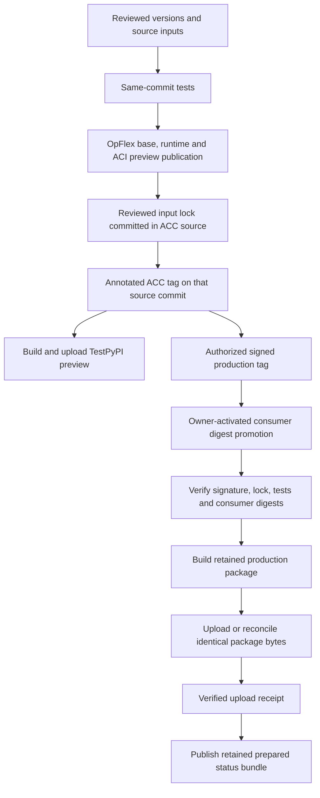

# ACI Containers Build and Release Process

> **Implemented review stacks; merge and activation are pending.** Public source
> baselines were refreshed on **2026-11-12**. The PRs below are unmerged proposals,
> including changes exercised by local fixture tests.
> Neither source inspection nor those tests proves deployed behavior. No target
> pipeline has been demonstrated end to end, and no production rehearsal is
> claimed. The process chapters describe the target in present tense; section 1
> identifies the current source and the remaining gates.

**Scope:** both `mmr-6.1.1` and the default pipeline. Product defaults are `master`;
shared `cicd` and `cicd-status` use `main`. Each line retains its release values.
These baselines use MMR `6.1.1.8` and `cicd/main` `6.1.2.1`; neither is a requested bump.

## Contents

1. [Status and baselines](#1-status-and-baselines)
2. [Architecture and ownership](#2-architecture-and-ownership)
3. [Release preparation](#3-release-preparation)
4. [Validation and authorization](#4-validation-and-authorization)
5. [Image publication](#5-image-publication)
6. [Package publication](#6-package-publication)
7. [Status, scans and provenance](#7-status-scans-and-provenance)
8. [Recovery and validation](#8-recovery-and-validation)
9. [Reference and activation](#9-reference-and-activation)

## 1. Status and baselines

### 1.1 Public source snapshots

These are audited source revisions, not evidence of a live run or deployment.

| Repository | `mmr-6.1.1` snapshot | Default snapshot |
|---|---|---|
| cicd | [`b186e92d`](https://github.com/noironetworks/cicd/commit/b186e92d4968aaf753ed26a43b76d23ab04d433d) | `main`: [`de12c4f7`](https://github.com/noironetworks/cicd/commit/de12c4f75c1377aa207d6adc6a78fcc2149f4299) |
| aci-containers | [`2db91e1f`](https://github.com/noironetworks/aci-containers/commit/2db91e1f1f92d7cf30736cba40bdff95fe64f74b) | `master`: [`dd8b98e6`](https://github.com/noironetworks/aci-containers/commit/dd8b98e69de94b52cf86ae1e14178b9555d12912) |
| opflex | [`8988eb64`](https://github.com/noironetworks/opflex/commit/8988eb64fa264427a63ff5dc6dab198107388f3a) | `master`: [`bf4812d4`](https://github.com/noironetworks/opflex/commit/bf4812d4f0bcf483cf17a7c1c160af908a1d411b) |
| acc-provision | [`26c2577c`](https://github.com/noironetworks/acc-provision/commit/26c2577c8aac6a2d0938aec1d8b5e5db6110f694) | `master`: [`b0e73e4f`](https://github.com/noironetworks/acc-provision/commit/b0e73e4fe4c773909bc9b14ede7964ae16b02689) |
| acc-provision-operator | [`fa49e7ee`](https://github.com/noironetworks/acc-provision-operator/commit/fa49e7ee4bc7c2e76d9cd09e45b37955ee846637) | `master`: [`e7f1526f`](https://github.com/noironetworks/acc-provision-operator/commit/e7f1526f61e95578523e5ad86ddbddeb0af9d22f) |
| cicd-status | Shared portal and records | `main`: [`41700b45`](https://github.com/noironetworks/cicd-status/commit/41700b45e6f4edefb0c791d67c149d3df7b41f06) |

The existing default-branch migration PRs remain a separate, unmerged source set:
[cicd #90](https://github.com/noironetworks/cicd/pull/90) at `23ca5a10`,
[OpFlex #698](https://github.com/noironetworks/opflex/pull/698) at `706c536a`,
[ACI #1801](https://github.com/noironetworks/aci-containers/pull/1801) at `e638e058`,
and [ACC #1470](https://github.com/noironetworks/acc-provision/pull/1470) at `076357b3`.
Their presence is not proof that the default branches have migrated.

The October 27 baseline is superseded. In particular, MMR cicd #88 has merged:
the current MMR source uses the legacy per-image status helper and shared
report files. ACI and OpFlex are **not** currently documented as using the old
batched publisher. Scanning is **not** documented as advisory at the baseline.

### 1.2 Implemented, unmerged review stacks

These PRs contain implemented proposals. They are not merged or activated;
local fixture tests are not deployment evidence. Hosted Linux results are reported
separately. MMR provider retirement updates the existing guard PRs in place.

| Family | Repository / scope | MMR | Default pipeline |
|---|---|---|---|
| F1 helpers | cicd | [#91](https://github.com/noironetworks/cicd/pull/91) | [#92](https://github.com/noironetworks/cicd/pull/92) |
| F2 provider retirement | opflex | [#691](https://github.com/noironetworks/opflex/pull/691) | [#699](https://github.com/noironetworks/opflex/pull/699) |
| F2 provider retirement | aci-containers | [#1774](https://github.com/noironetworks/aci-containers/pull/1774) | [#1802](https://github.com/noironetworks/aci-containers/pull/1802) |
| F2 provider retirement | acc-provision | [#1461](https://github.com/noironetworks/acc-provision/pull/1461) | [#1471](https://github.com/noironetworks/acc-provision/pull/1471) |
| F2 retired-image policy | acc-provision-operator | [#56](https://github.com/noironetworks/acc-provision-operator/pull/56) | [#57](https://github.com/noironetworks/acc-provision-operator/pull/57) |
| F1 callers | opflex | [#700](https://github.com/noironetworks/opflex/pull/700) | [#701](https://github.com/noironetworks/opflex/pull/701) |
| F1 callers | aci-containers | [#1803](https://github.com/noironetworks/aci-containers/pull/1803) | [#1804](https://github.com/noironetworks/aci-containers/pull/1804) |
| F1 callers | acc-provision | [#1472](https://github.com/noironetworks/acc-provision/pull/1472) | [#1473](https://github.com/noironetworks/acc-provision/pull/1473) |
| F3 portal | cicd-status | Shared [#20](https://github.com/noironetworks/cicd-status/pull/20) | Same shared portal |
| F4 CVE refresher | Owner deployment gated | Private team review | Private team review |
| F6 / P1–P2 policy | cicd | [#93](https://github.com/noironetworks/cicd/pull/93) | [#94](https://github.com/noironetworks/cicd/pull/94) |
| F5 scan helpers | cicd | [#95](https://github.com/noironetworks/cicd/pull/95) | [#96](https://github.com/noironetworks/cicd/pull/96) |
| F5 advisory callers | opflex | [#702](https://github.com/noironetworks/opflex/pull/702) | [#703](https://github.com/noironetworks/opflex/pull/703) |
| F5 advisory callers | aci-containers | [#1805](https://github.com/noironetworks/aci-containers/pull/1805) | [#1806](https://github.com/noironetworks/aci-containers/pull/1806) |
| B1 immutable input child | opflex | [#704](https://github.com/noironetworks/opflex/pull/704) | [#705](https://github.com/noironetworks/opflex/pull/705) |
| B1 immutable input child | aci-containers | [#1807](https://github.com/noironetworks/aci-containers/pull/1807) | [#1808](https://github.com/noironetworks/aci-containers/pull/1808) |
| F7 guide | cicd | Shared [#86](https://github.com/noironetworks/cicd/pull/86) | Updated in place |

**Selected MMR helper pin:** [`ed91df64e63184ab5a5171d0705062ae57c664a7`](https://github.com/noironetworks/cicd/blob/ed91df64e63184ab5a5171d0705062ae57c664a7/travis/ci_evidence.py).
**Selected Default helper pin:** [`ed481aacc481c16aeee26290120b7a08a8680c67`](https://github.com/noironetworks/cicd/blob/ed481aacc481c16aeee26290120b7a08a8680c67/travis/ci_evidence.py).
F1 callers retain fatal scan policy with these exact pins; advisory activation
remains gated on deployed readers/refresher and separate caller PRs.

### 1.3 Capability and current limitations

| Capability | Current evidence | Target / remaining gate |
|---|---|---|
| MMR tag-triggered GHA releases | Workflows exist alongside provider-selection/Travis paths | F2 removes provider selection; owner verifies external service settings |
| ACI unit validation | [Run 43318463383](https://github.com/noironetworks/aci-containers/actions/runs/43318463383) fails in GBPserver with concurrent map writes; product/test code is unchanged | Existing product-test failure; policy checks do not establish release readiness |
| Default-branch GHA migration | The four PR heads above are unmerged | Review both lines independently and preserve their versions |
| Approved CICD revision | Branch-based selection remains in baseline workflows | F1 callers require an exact reviewed commit and verify checkout before credentials |
| Image/status separation | Legacy helper runs per image; shared temporary reports can be overwritten | F1 retains each completed image's evidence and publishes a prepared bundle |
| Scan outage behavior | Baseline scan failures can stop later publication | F1 retains fatal behavior; F5 advisory mode requires separate activation |
| Scan result and freshness | Baseline portal consumes legacy severity fields | F3–F5 add explicit results; missing evidence never means zero findings |
| ACC package publication | Baseline build/upload/status are coupled | F1/F6 separate build, upload and status jobs with retained bytes and receipts |
| Production authorization | Existing signed-tag authority must be preserved and checked | F6 verifies the authorized key and identity plus committed inputs and tests |
| Recovery | Full reruns can rebuild/re-push and fail after branch-head movement | F1/F6 add retained-evidence repair; this does not prove every full rerun is safe |
| Consumer plain-tag readiness | Packages can refer to tags that need independent verification | F6 proposes verified promotion and locked-digest checks; owner activation and real-registry verification remain prerequisites |
| Scheduled refresh | External job configuration, schedule and push wrapper are unverified | Owner installs F4 and removes any legacy force-push path |
| Live controls | Jenkins settings, variables, signing policy, required checks and notifications are not established by this audit | Owners verify them before activation |

Public source does not establish actual Jenkins tag creation, current repository
variables, production key availability, scanner/registry access, branch
protection, job schedules, or deployed portal assets. Local tests do not fill
those gaps. Notification and missed-run monitor building blocks remain inactive
until owners supply the destination, ownership and thresholds. No automatic
notification service is claimed.

## 2. Architecture and ownership

| Role | Responsibility |
|---|---|
| Release owners | Review version changes, source commits, dependency evidence and activation |
| Jenkins owner | Verify external tag-producing configuration and release-line values |
| Product GHA workflows | Run unprivileged tests; validate, build and publish the approved line |
| Shared CICD scripts | Prepare evidence, apply policy and perform bounded status transactions |
| Status repository and portal | Retain release records and display build/refresh observations |
| Refresh owner | Operate the scheduled refresher and verify its configuration and publication path |

Jenkins remains the tag producer. GitHub Actions does not add a manual approval
step or replace the existing production authority. Production approval is the
valid release-tag signature from the authorized key and identity.



This target flow does not assert atomic publication across repositories or registries. Travis publication is retired in the target; a
provider variable does not re-enable it. The retired `acc-provision-operator`
repository has policy-test CI only, not an image producer.

## 3. Release preparation

### 3.1 Version and configuration update points

Review these together, separately for MMR and the default line:

- `travis/globals.sh`: `RELEASE_TAG`.
- Each product repository's `UPSTREAM_ID` Actions variable and source-branch selection.
- ACI `EXPECTED_OPFLEX_BASE_DIGEST` binds to `vars.MMR611_OPFLEX_BASE_DIGEST` on MMR and `vars.MASTER_OPFLEX_BASE_DIGEST` on default: use that line's verified OpFlex base publication, never one global value across lines.
- ACC `provision/setup.py`: package version.
- ACC `provision/acc_provision/versions.yaml`: consumer image pins and their classification.
- Every caller's exact `CICD_COMMIT` pin, matching the approved helper revision and release.
- ACC `ci/release-inputs.json`: the reviewed input lock committed before tagging.
- The authorized public signing policy/key files, without changing the existing authority.
- External Jenkins release settings, explicitly verified by their owner.

Any remaining placeholder fails before credentials; do not replace an exact pin
with a moving branch. Owners verify source-branch overrides on both lines.

### 3.2 Input lock and source identity

`travis/create_release_lock.py` creates a reviewable lock from retained,
hash-validated ACI and OpFlex bundles, `versions.yaml`, and an explicit OpFlex
build-base dependency. The lock contains the release, source branch, exact CICD
commit, producer commits/run identities, and supported image/dependency digests.
The owners review and commit `ci/release-inputs.json` before creating the ACC tag.

The lock excludes its enclosing ACC source SHA and tag-object ID. Including the
hash of the commit containing the lock would be recursive. Runtime verification
binds the committed lock to the tagged ACC source and records the source and tag
object separately. Editing a working-tree lock after tagging fails verification.

### 3.3 Supported inputs

The supported set is nine runtimes plus `opflex-build-base` (section 9.1).
The lock requires producer/registry identity, not a mutable alias or workflow name.

`gbp_version` and `opflex_server_version` have no supported producer in this
release path. Classify historical pins before relying on them. The retired
`acc-provision-operator` is distinct from the supported `aci-containers-operator`.

## 4. Validation and authorization

### 4.1 Unprivileged validation

Product tests retain these check names:

- ACC: `Lint and unit tests`.
- ACI: `aci-containers unit tests`.
- OpFlex: `OpFlex unit tests`.

`CI policy fixtures` runs the workflow/source guards on Linux, with pinned test
tooling and no production credentials. Shared CICD, portal and refresher changes
have their own CI. Required-check configuration and successful hosted runs are
separate evidence; a source file alone does not make a check required.

### 4.2 Tag and helper checks

A release tag has numeric form `N.N.N.N`, is annotated, resolves to the intended
source commit, and agrees with the selected CICD `RELEASE_TAG`. `UPSTREAM_ID` is
present and well formed. The caller fetches the exact reviewed CICD commit and
verifies `HEAD` before publication credentials become available.

Initial branch-head checks remain visible in the current caller proposals.
Status-only recovery uses retained source identity; it does not replay the full
build workflow or claim that a moved branch is harmless to every rerun.

### 4.3 Production authority

An authorized maintainer signs the release tag on the **same ACC source commit**.
This changes the **tag object**, not the source commit or committed input lock.
The new object selects production publication. After production, release owners
freeze the tag and source identity. This guide provides no tag-replacement or
signature-bypass procedure.

`travis/release_policy.py` verifies a valid signature from the authorized key and
identity, the signed source's committed lock, matching helper revision, package
identity, dependency observations and required same-commit checks. It rejects
missing, skipped, neutral, failed or stale authorization evidence. The uploader
rechecks the approved identity before using a package credential. No manual
GitHub approval is introduced.

## 5. Image publication

### 5.1 Dependency order

OpFlex publishes its build-base dependency first. Runtime and ACI consume the
approved base identity, and retained evidence associates each runtime image with
its actual build-time base. ACI host images use the minimal base, not the
controller's full base. Missing pre-build base provenance is unavailable evidence,
not a guessed digest.

The proposed OpFlex input children pass `OPFLEX_BUILD_BASE_IMAGE` as an immutable
`repository@digest` into `Dockerfile-opflex-build` in prepared runtime mode. The
legacy tag remains the Dockerfile default outside that mode. The MMR phase and
pre-Maven digest checks are preserved. The default line still requires the
author-owned phase fix; these input children do not copy it or claim to fix that
blocker. Shell/Docker fixtures do not establish an end-to-end real build.

### 5.2 Tag order and partial failure

The external tag formats remain `<release>.<upstream>`,
`<release>.<upstream>.MMDDYY.<run_number>`, and `<release>.<upstream>.z`.
A retry attempt keeps its original run number; run ID, run number and attempt
remain distinct provenance fields.

The target publishes and verifies per-registry digests before moving consumer
`.z` aliases; the downstream-readable noirolabs `.z` moves **last**. This orders
publication; it does not make a multi-registry operation atomic or authorize
production consumer plain tags.

A partial push is a critical forward-only recovery case. Earlier registry writes
remain published. Retained evidence identifies the completed image prefix; logs
and registry observations establish the failing image's actual partial writes.
The run fails visibly and later images stop under fatal policy. Recovery uses
those recorded inputs and observed digests. It does not roll back published tags,
force-push status history, or declare an incomplete image set ready.

### 5.3 Consumer plain tags

Production uses approved consumer plain tags on Quay and Docker Hub. F6 proposes
`travis/promote_consumer_images.py`: it verifies the existing authorized signature
and locked test cohort before opening registry auth files, preflights every source
and destination, and copies immutable manifests without rebuilding or replacing
conflicting tags. A retained receipt supports forward resume after partial work.

Promotion precedes package production authorization. It is not automatic in the
caller workflows: the owner first configures the cohort, destinations and scoped
auth files. This operator command uses the approved checkout and retained evidence;
it adds no manual GitHub approval and does not change the signing authority:

```sh
python3 "$APPROVED_CICD_CHECKOUT/travis/release_policy.py" collect-cohort-checks \
  --policy "$APPROVED_CICD_CHECKOUT/travis/release-policy.json" \
  --lock "$APPROVED_ACC_CHECKOUT/ci/release-inputs.json" \
  --source-sha "$APPROVED_ACC_SOURCE_SHA" --output "$RETAINED_COHORT_CHECKS"
python3 "$APPROVED_CICD_CHECKOUT/travis/promote_consumer_images.py" \
  --repository "$APPROVED_ACC_CHECKOUT" --tag "$RELEASE_TAG" \
  --policy "$APPROVED_CICD_CHECKOUT/travis/release-policy.json" \
  --public-key "$AUTHORIZED_PUBLIC_KEY_FILE" \
  --lock "$APPROVED_ACC_CHECKOUT/ci/release-inputs.json" \
  --checks "$RETAINED_COHORT_CHECKS" --receipt "$PROMOTION_RECEIPT" \
  --quay-authfile "$QUAY_CONSUMER_AUTHFILE" --docker-authfile "$DOCKER_CONSUMER_AUTHFILE"
```

The policy re-observes consumer digests before package upload. Local promoter
fixtures are not proof that real registry promotion or this activation has run.

## 6. Package publication

### 6.1 Selection and retained bytes

The tag selects exactly one package index through the existing publication mode.
`release to test.pypi.org` selects preview; `release to pypi.org` selects production.
Ambiguous selection fails. Existing RC naming and release/RC status semantics
remain separate modes; a preview is not silently promoted by rebuilding it.

Preview uses `<release>.dev<run_number>` and preview image references. Production
uses `<release>` and locked consumer plain references. The builder sets the final
version before creating the source distribution and records filename, size,
SHA-256, source commit, helper commit and index in `package-manifest.json`.

Production builds `acikubectl` from the ACI commit in the signed input lock and
records the actual ACI source SHA in the package manifest. Authorization and
upload reject a mismatch. These strict locked-input gates are production-only;
preview retains its existing input route.

### 6.2 Three separate jobs

1. **Build:** validate inputs and create the retained package, manifest and prepared
   status bundle. This job has neither package-upload nor status-write credentials.
2. **Upload:** retrieve the retained bytes, validate their manifest, apply production
   policy when needed, and upload or reconcile the exact existing file. Only this
   job's upload step receives its package credential.
3. **Status:** consume the retained bundle and a verified upload receipt. Only the
   status publication step receives its status credential; it does not rebuild,
   rescan, upload, or query the package index.

Producer-job outputs retain the prepared-artifact name, receipt-artifact name and
original evidence attempt. A failed-jobs rerun uses those outputs rather than
inventing artifact names or comparing against the repair job's newer attempt.

The selected TestPyPI/PyPI secret bindings migrate to index-scoped API tokens
before activation. The uploader uses literal username `__token__`; legacy account
passwords are rejected. Owners verify bindings without exposing their values.

### 6.3 Existing package versions

`release_policy.py upload` compares the retained filename and SHA-256 with the
package index. An identical existing file is accepted as already uploaded; a
mismatch stops. The verified receipt binds the package, official index, source
and CICD identities. Production additionally binds the signed tag object and
input-lock hash. A different corrected file requires an owner-selected new
version, not replacement under an existing filename.

## 7. Status, scans and provenance

### 7.1 Prepared bundle API

`travis/ci_evidence.py prepare-images` and `prepare-package` construct a local
bundle with manifest, hashes, source/helper/run identities and retained artifacts.
Preparation is the observation stage and may invoke Docker or inspect existing
status for release/RC carry-forward. It runs without a status-write credential.

`ci_evidence.py publish` validates and merges the retained bundle into a fresh
status checkout. Trusted caller scope fixes release, kind, full stream name,
source/helper commits, original run identity and allowed image set; these values
never come from the bundle being validated. Packages also require `--receipt`.
This data-only stage
has no Docker/scanner/package-index observation. It seeds missing release/stream
entries, preserves unrelated records and uses bounded fresh-clone normal-push
retries. Reapplying the same verified bundle is idempotent. A status error remains
a failure even when artifact publication succeeded.

Image preparation and status can retain a successful prefix after a later image
fails. This proposed behavior replaces the baseline legacy per-image helper and
shared temporary report handling; it is not a claim about deployed MMR behavior.

### 7.2 Explicit scanner policy

`CI_EVIDENCE_MODE=prepared-v1` selects the proposed prepared publisher contract.
`CI_SCAN_POLICY=fatal` is the default: scanner failure stops publication. Enabling
prepared evidence does **not** enable advisory scanning.

`CI_SCAN_POLICY=advisory` is a separately reviewed activation. In that mode scan
outages are explicit observations while publication can continue. Registry or
status failures still fail. No placeholder report or parse failure becomes a
clean scan with zero findings. F5 must be paired with its consumer contract;
legacy parsing alone does not provide this guarantee.

### 7.3 Build and refresh observations

The F5 advisory contract gives each image independent `scan.build` and
`scan.refresh` namespaces, each with `image` and `base` observations. Result is one of `ok`, `unavailable`, `queued`,
`unsupported`, or `error`. Counts exist only for valid completed evidence.
Scanner, digest, observation time and report identify the evidence being shown.

Freshness is separate: `fresh`, `stale`, or `unknown`. Without an explicit positive
age policy, freshness is **unknown**. A published fresh observation expires under
that policy; freshness never changes a failed result into success. Historical
`last_success` retains its own digest, timestamp and report and is labeled
historical, not current. Legacy records remain readable.

The scheduled refresher writes only its refresh namespace and retained reports.
It keeps build-time base A intact when the mutable tag now resolves to B, records
B separately, and chooses the correct `linux/amd64` child manifest for scanning.
A stale scan of image A cannot replace a newer build B. These are F4 proposals;
the external owner must verify its deployed launcher, schedule, concurrency,
timeouts and normal-push path before activation.

### 7.4 Retention and archive limits

Status Git retains release rows, component-index source/CICD/bundle-hash evidence and canonical run history.
Package rows retain link/tag/source/build-log fields; the package SHA-256, full manifest and verified receipt do not persist there.
Bundle/package/manifest/receipt artifacts currently have the workflow's 14-day retention.
Owners archive and verify them before expiry when longer repair is required.
No durable archive destination or completed archive verification is claimed here.

## 8. Recovery and validation

### 8.1 Status-only package repair

Use the already retained prepared bundle and verified upload receipt with the
same approved helper revision. The owner verifies the destination before the
write; variable names below stand for reviewed values, not default destinations.

```sh
python3 "$APPROVED_CICD_CHECKOUT/travis/ci_evidence.py" publish \
  --bundle "$RETAINED_STATUS_BUNDLE" \
  --receipt "$VERIFIED_UPLOAD_RECEIPT" \
  --expected-release-tag "$APPROVED_RELEASE_TAG" --expected-kind package \
  --expected-stream "$APPROVED_RELEASE_STREAM" \
  --expected-source-repository "$APPROVED_SOURCE_REPOSITORY" \
  --expected-source-sha "$APPROVED_SOURCE_SHA" --expected-cicd-sha "$APPROVED_CICD_SHA" \
  --expected-run-id "$ORIGINAL_RUN_ID" --expected-run-attempt "$ORIGINAL_RUN_ATTEMPT" \
  --expected-images "$APPROVED_RUNTIME_IMAGES" \
  --repository "$VERIFIED_STATUS_REPOSITORY" \
  --branch "$VERIFIED_STATUS_BRANCH"
```

The expected scope comes from approved source/run records, not bundle fields.
The full stream is `<release>.z`, `<release>`, or `<release>.rcN`; the package image
CSV is empty for preview and contains all nine runtimes for release/RC.
This command does not prepare a new bundle or use a package credential. A
missing/mismatched receipt fails. If the receipt was lost, index reconciliation
through the approved upload policy is a separate, explicitly scoped operation;
it verifies identical bytes and produces a receipt before status repair.
Re-running `prepare-package` is not status-only repair: release/RC preparation
performs observations and can create different evidence.

### 8.2 Local checks

Run these in the corresponding reviewed proposed checkout. They use fixtures;
they do not qualify a production release or establish a live deployment.

```sh
# Shared CICD helpers and policy (Python 3.12 or later).
python3 -m pip install -r requirements-test.txt
python3 -m unittest discover -s tests -v

# Each product checkout, including the retired operator's policy CI.
python3 -m pip install -r tests/ci/requirements.txt 'PyYAML==6.0.2'
python3 -m unittest discover -s tests/ci -v

# Portal checkout, using Node 22.14.0.
npm ci
npm test
npx playwright install chromium
npm run test:browser
```

The refresh owner separately runs the refresher's actual-CLI fixtures with fake
HTTP/Docker and temporary bare Git repositories. Hosted Linux CI results, exact
reviewed heads and any failed checks are retained separately from local results.

### 8.3 Rehearsal and activation boundary

No real rehearsal has been performed for this target. A future rehearsal uses
explicit disposable status, image and package destinations with owner-approved
limited credentials. It verifies the effective destination before every write.
The old smoke path or a status-branch variable alone is not a safe rehearsal:
legacy scripts can still select production repositories or `main`.

Exercise scanner outage, partial registry push, missing/invalid receipt, identical
and conflicting package files, concurrent status writers, stale digest updates,
and status-only repair. Preserve actual remote state and run evidence. Advancing
aliases or partial package/image publication is forward-only; never roll it back
to hide a failed rehearsal or production run.

## 9. Reference and activation

### 9.1 Supported image inventory

| Image | Producer | ACC version key |
|---|---|---|
| `opflex-build-base` | OpFlex base | Build dependency |
| `opflex` | OpFlex runtime | `opflex_agent_version` |
| `aci-containers-host` | ACI | `aci_containers_host_version` |
| `aci-containers-host-ovscni` | ACI | `aci_containers_host_ovscni_version` |
| `aci-containers-controller` | ACI | `aci_containers_controller_version` |
| `aci-containers-operator` | ACI | `aci_containers_operator_version` |
| `aci-containers-webhook` | ACI | `aci_containers_webhook_version` |
| `aci-containers-certmanager` | ACI | `aci_containers_certmanager_version` |
| `cnideploy` | ACI | `cnideploy_version` |
| `openvswitch` | ACI | `openvswitch_version` |

### 9.2 Activation checklist

1. Review and merge the intended implementation families for the selected line;
   replace CICD placeholders with exact reviewed commits and verify every checkout.
2. Confirm required hosted tests and the authorized signing policy without changing
   production authority or adding a manual GitHub approval.
3. Commit the reviewed input lock before tagging and preserve its runtime source
   and tag-object binding. Verify image readiness and consumer promotion separately.
4. Have owners verify Jenkins, repository variables, retired provider settings,
   refresh configuration, notification/monitoring and all publication destinations.
5. Complete the isolated failure/recovery rehearsal; verify owner archival and retention before artifact expiry.
6. Activate fatal-compatible evidence first; advisory caller children remain gated
   on deployed portal/refresher consumers and separate scan-policy approval.
7. Verify the actual package receipt, remote status records and deployed portal
   after publication. Update section 1 only with that observed evidence.
